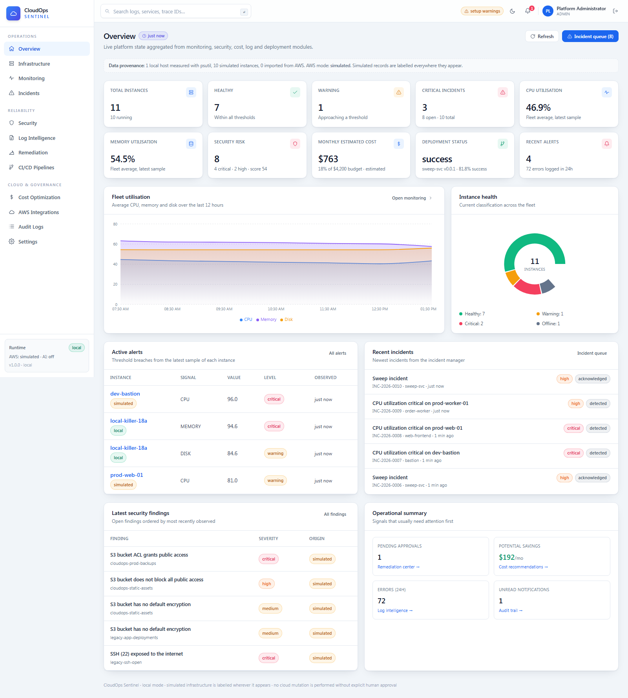
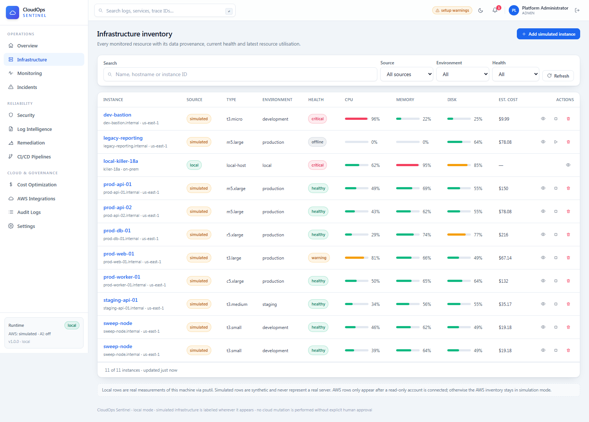
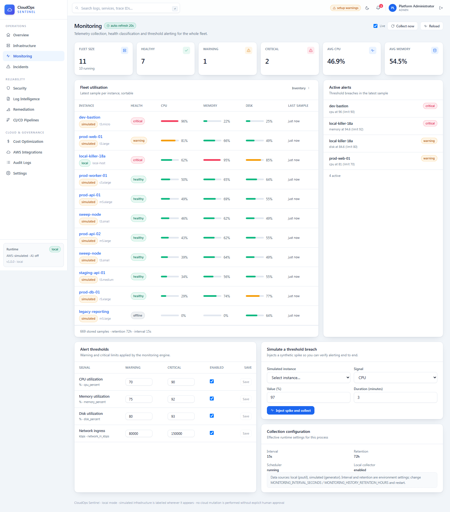
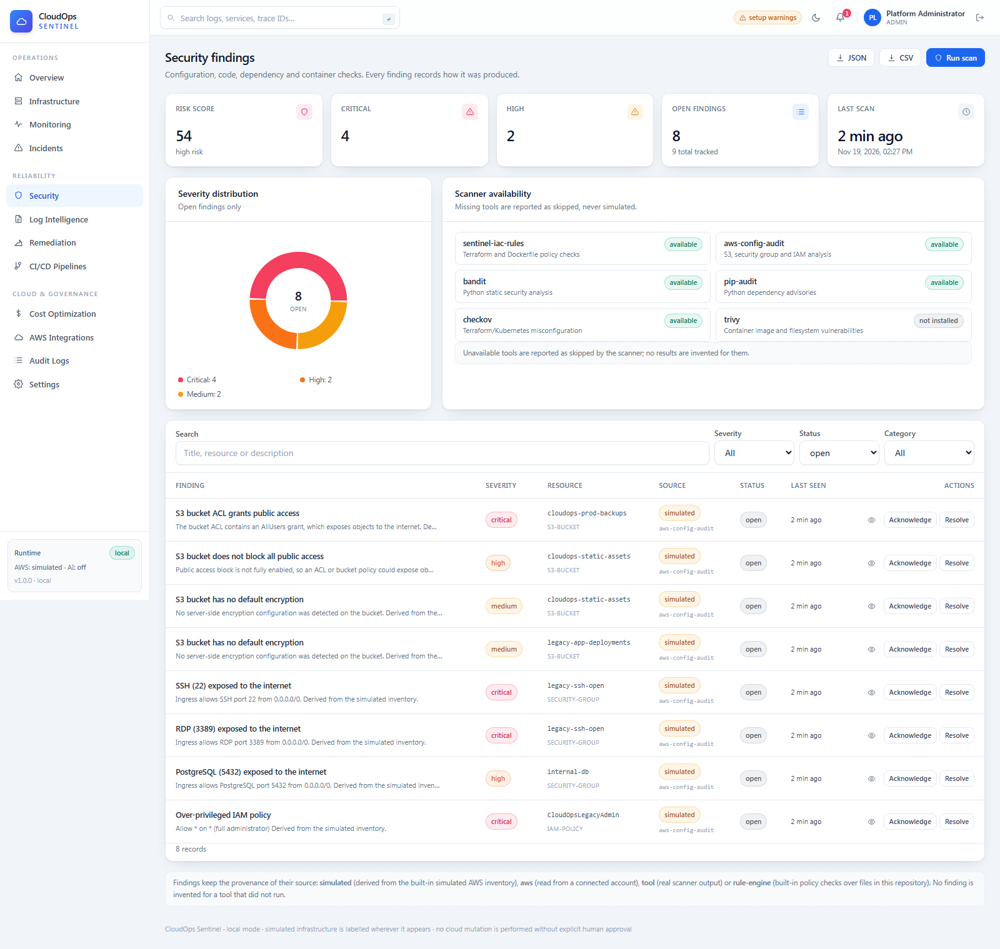
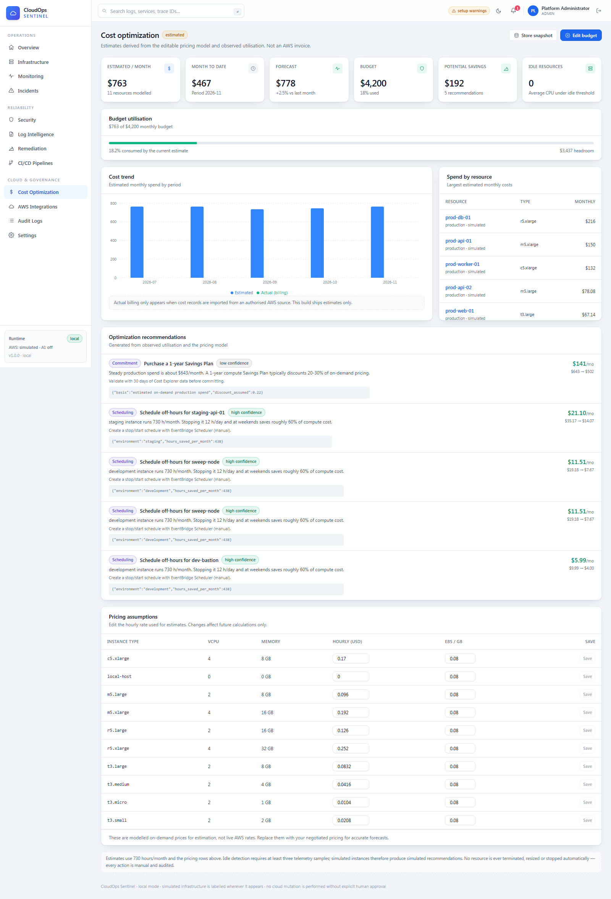
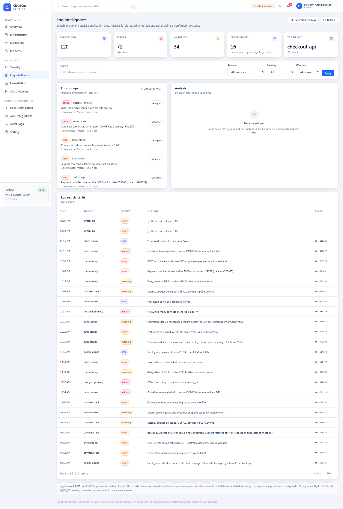
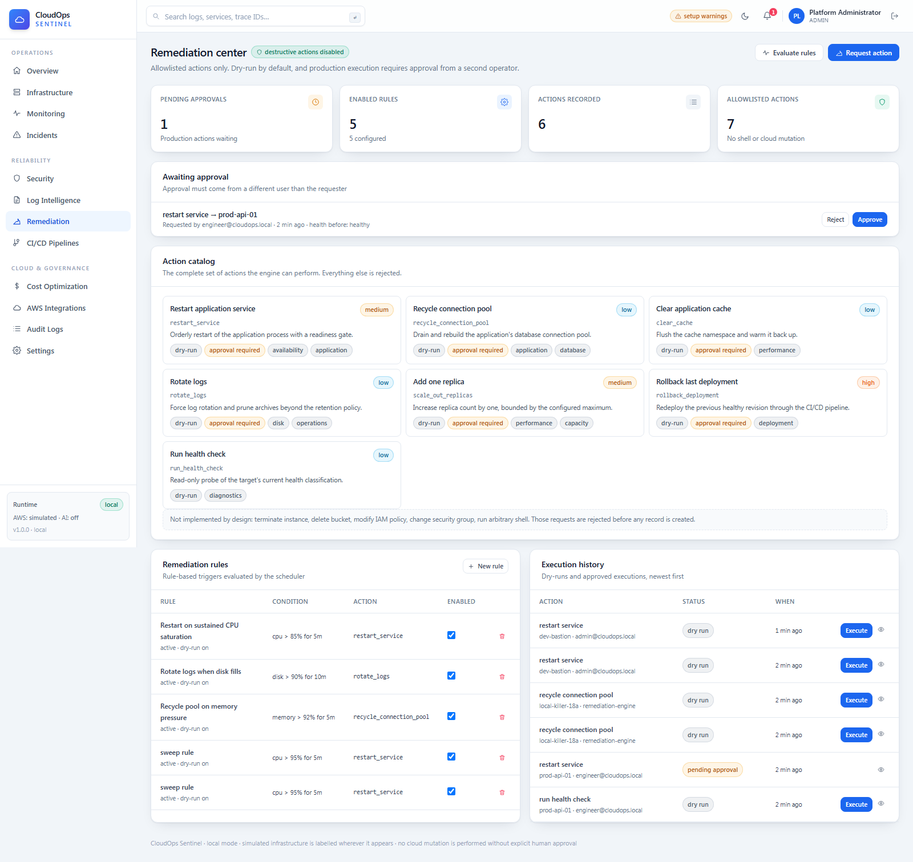
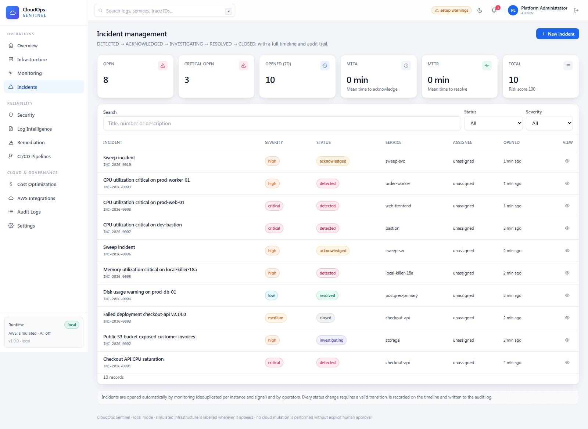
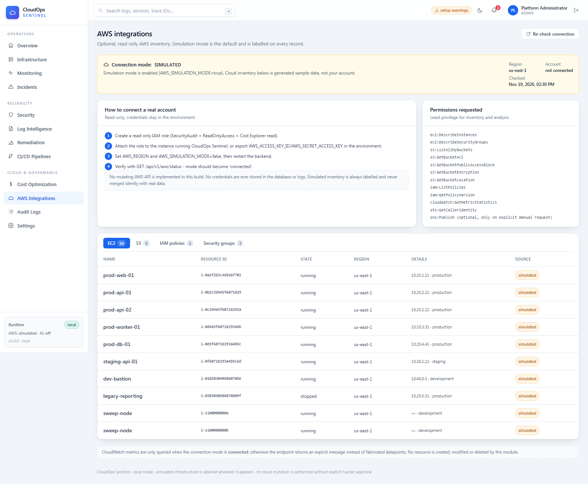
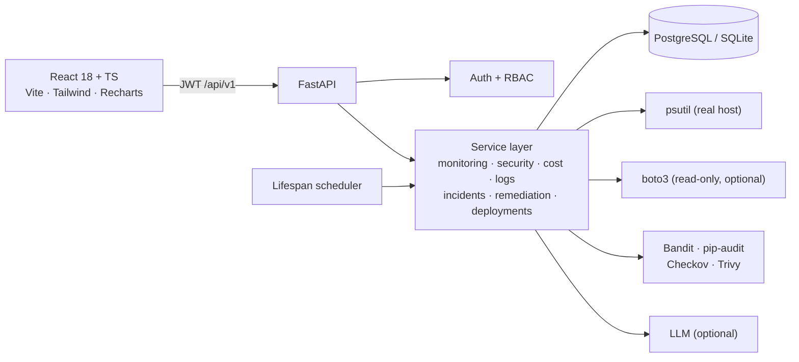

# CloudOps Sentinel

[](https://github.com/Divakar-v-cse/cloudops-sentinel/actions/workflows/ci.yml)

**AI-powered cloud operations and auto-remediation platform** — infrastructure monitoring, AWS inventory,
security scanning, cost optimisation, log intelligence, incident response and human-approved remediation in one
console.

Runs entirely **locally** with SQLite + real host metrics. No AWS account, no paid API and no cloud spend are
required to evaluate it. Every synthetic record is labelled as such, in the database and in the UI.



---

## Contents

[Features](#features) · [Screenshots](#screenshots) · [Architecture](#architecture) ·
[Quick start](#quick-start) · [Configuration](#configuration) · [API](#api) ·
[Testing](#testing) · [Security](#security) · [Docker & Kubernetes](#docker-and-kubernetes) ·
[Terraform](#terraform) · [CI/CD](#cicd) · [Documentation](#documentation) · [Status](#status)

---

## Features

| Module | What it does | Provenance |
| --- | --- | --- |
| **Dashboard** | Fleet health, utilisation, open incidents, security risk, estimated spend, deployment state, live alerts | Aggregated from live APIs |
| **Infrastructure** | Inventory with health, type, environment and per-resource utilisation; add simulated nodes | `local` / `simulated` / `aws` badge on every row |
| **Metrics** | CPU, memory, disk and network history with 1h/6h/24h/72h windows, threshold overlays | `source` column per sample |
| **Alerts** | Configurable warning/critical thresholds, live breach derivation, rate-limited notifications | Derived, never stored fiction |
| **Incidents** | `DETECTED → ACKNOWLEDGED → INVESTIGATING → RESOLVED → CLOSED`, enforced server-side, with timeline and MTTA/MTTR | Auto-opened from monitoring, deduplicated |
| **AI Log Intelligence** | Batched ingest, fingerprint grouping, severity classification, root-cause hypotheses, debug commands | `ai` only with a configured key, else `rule-based` |
| **Cost Optimisation** | Editable pricing model, monthly trend, budget tracking, idle/oversized/scheduling recommendations | Always flagged **estimated** |
| **Security Scanner** | Bandit, pip-audit, Checkov, Trivy + built-in Terraform/Docker/AWS-config rules; JSON & CSV export | `tool` / `rule-engine` / `aws` / `simulated`; missing tools report `skipped` |
| **Auto-Remediation** | 7 allowlisted actions, dry-run default, health checks, four-eyes approval, execution history | `[SIMULATED]` output; no destructive action exists |
| **Audit Logs** | Append-only record of logins, scans, threshold changes, incident transitions, approvals | Actor + entity + structured detail |

Roles: `admin`, `engineer`, `analyst`, `viewer` (JWT HS256, PBKDF2-HMAC-SHA256 password hashing).

---

## Screenshots

Every image in [`screenshots/`](screenshots) was captured from the running application with Playwright
(`scripts/capture-screenshots.mjs`). [`manifest.json`](screenshots/manifest.json) records the route, title and
console errors per capture — currently **0 errors on all 14 pages**.

| | |
| --- | --- |
|  **Infrastructure inventory** |  **Monitoring & thresholds** |
|  **Security findings** |  **Cost optimisation** |
|  **Log intelligence** |  **Remediation centre** |
|  **Incident queue** |  **AWS integrations** |

Also captured: `00-login.png`, `instance-detail.png`, `pipelines.png`, `audit-logs.png`, `settings.png`,
`overview-alt-theme.png`.

---

## Architecture



Full component and sequence diagrams, the provenance contract and failure behaviour live in
[docs/architecture.md](docs/architecture.md).

### Repository layout

```
cloudops-sentinel/
├── backend/                  FastAPI app, 17 SQLAlchemy models, Alembic, 59 tests
│   ├── app/{api,core,db,models,schemas,services}
│   ├── alembic/versions/     initial migration (verified against a fresh DB)
│   └── tests/
├── frontend/                 React 18 + TypeScript + Vite + Tailwind + Recharts
│   └── src/{api,components,context,hooks,lib,pages}
├── infrastructure/
│   ├── terraform/            VPC, EC2 (opt-in), S3, IAM, CloudWatch, SNS
│   └── kubernetes/           namespace, config, statefulset, deployments, HPAs
├── monitoring/               Prometheus scrape config + alert rules
├── security/                 bandit/trivy configs and real scan reports
├── cicd/                     pipeline documentation (actions + jenkins)
├── scripts/                  setup, test-all, security-scan, screenshot capture
├── docs/                     architecture, installation, API, troubleshooting, demo,
│                             interview guide, resume description
├── demo/                     demo assets and seed script
├── screenshots/              real captures + manifest
├── tests/integration/        live end-to-end API check
├── .github/workflows/        ci.yml, release.yml (executed by GitHub from here)
├── Jenkinsfile · docker-compose.yml · .env.example · LICENSE · README.md
```

> GitHub only runs workflows from `.github/workflows`, so those files are canonical and `cicd/` documents them
> rather than duplicating them (duplicates drift).

---

## Quick start

```bash
python3.12 -m venv .venv && source .venv/bin/activate    # Windows: .\.venv\Scripts\Activate.ps1
pip install -r backend/requirements.txt -r backend/requirements-dev.txt

cp .env.example backend/.env        # Windows: copy .env.example backend\.env
# edit SECRET_KEY and DEFAULT_ADMIN_PASSWORD

# terminal 1
cd backend && PYTHONPATH=. uvicorn app.main:app --port 8000 --reload

# terminal 2
cd frontend && npm install && npm run dev
```

| Service | URL |
| --- | --- |
| UI | http://localhost:5173 |
| API | http://127.0.0.1:8000 |
| Swagger / ReDoc | `/docs` · `/redoc` |
| Health / metrics | `/health` · `/metrics` |

**Seeded logins** (passwords from `.env`; dev fallbacks shown):

| Email | Role | Password |
| --- | --- | --- |
| `admin@cloudops.local` | admin | `Admin@12345` |
| `engineer@cloudops.local` | engineer | `Admin@12345` |
| `analyst@cloudops.local` | analyst | `Analyst@12345` |

First boot seeds roles, users, 8 simulated instances, the real local host, ~500 telemetry samples, log history,
incidents, findings, rules and deployments. Idempotent — seeds are skipped when data exists. Change the passwords
before exposing the service; the runtime reports when defaults are still in use.

Port 8000 busy?

```powershell
$env:VITE_PROXY_TARGET="http://127.0.0.1:8010"; npm run dev   # API started with --port 8010
```

Docker, Kubernetes, Terraform and AWS connection instructions: [docs/installation.md](docs/installation.md).

---

## Configuration

Environment-driven via pydantic-settings (`backend/.env` for the API, root `.env` for Compose). See
[.env.example](.env.example). Nothing is hardcoded; the only defaults are non-sensitive development
placeholders the runtime warns about.

| Variable | Default | Purpose |
| --- | --- | --- |
| `SECRET_KEY` | dev placeholder | JWT signing — replace for shared deployments |
| `DATABASE_URL` | `sqlite:///…/cloudops.db` | `postgresql+psycopg://…` for PostgreSQL |
| `ENABLE_SCHEDULER` | `true` | Background collection + rule evaluation |
| `MONITORING_INTERVAL_SECONDS` | `15` | Collection cadence |
| `AWS_SIMULATION_MODE` | `true` | Must be explicitly disabled to query a real account |
| `AWS_REGION` | `us-east-1` | boto3 region |
| `AI_PROVIDER` / `AI_API_KEY` | `none` | Optional LLM log explanation |
| `COST_BUDGET_USD` | `3000` | Budget card + over-budget state |
| `LOG_RETENTION_DAYS` | `14` | Retention window |

---

## API

Interactive docs at `/docs`. Full reference with payloads and error semantics: [docs/api.md](docs/api.md).

```bash
TOKEN=$(curl -s -X POST localhost:8000/api/v1/auth/login -H 'Content-Type: application/json' \
  -d '{"email":"admin@cloudops.local","password":"Admin@12345"}' | jq -r .access_token)

curl -s localhost:8000/api/v1/dashboard/overview -H "Authorization: Bearer $TOKEN" | jq '.instances'
curl -s -X POST localhost:8000/api/v1/security/scan -H "Authorization: Bearer $TOKEN" \
  -H 'Content-Type: application/json' -d '{"tools":["rules","aws","bandit"],"include_cloud":true}' | jq
```

~80 routes across auth, instances, monitoring, security, costs, logs, incidents, remediation, deployments,
AWS, audit, notifications and settings.

---

## Testing

```bash
cd backend
PYTHONPATH=. pytest                  # 59 tests, temporary SQLite, scheduler off
ruff check app tests
cd ../frontend && npm run build      # tsc -b + vite build

# live end-to-end (server must be running)
python tests/integration/live_api_check.py --base-url http://127.0.0.1:8000
```

**Measured in this environment:** 59/59 pytest · ruff clean · frontend production build succeeds · live
integration check **33/33** · Playwright captures 14 pages with **0 console errors**.

Test layers: [tests/README.md](tests/README.md).

---

## Security

* **Repository scan (2026-11-18):** Bandit 0 high / 0 medium / 18 low (accepted, justified); pip-audit
  **0 vulnerabilities across 44 packages** after upgrading `fastapi` 0.163.2, `starlette` 1.10.0,
  `python-multipart` 0.0.34, `PyJWT` 2.15.1; one HIGH Bandit finding (`B324` SHA-1 fingerprint) fixed in code.
  Full report: [security/reports/security-scan-2026-11-18.md](security/reports/security-scan-2026-11-18.md).
* **Secrets:** none committed. `.gitignore` excludes `.env`, keys and Terraform state; Compose refuses to start
  without explicit secrets; `/settings/runtime` masks the DSN and never returns keys.
* **Passwords:** PBKDF2-HMAC-SHA256, 390,000 iterations, 16-byte per-user salt.
* **Remediation safety:** allowlist only (7 reversible actions), dry-run default, health checks before/after,
  four-eyes approval, execution blocked before approval, full audit trail. `terminate_instance`, `delete_bucket`,
  IAM/security-group mutation and arbitrary shell **do not exist** in the codebase.
* **AWS:** read-only calls only; no mutating API is implemented anywhere.
* **Headers:** `X-Content-Type-Options`, `X-Frame-Options: DENY`, `Referrer-Policy`, `Permissions-Policy`, plus a
  CSP in the nginx image.

### AWS cost warning

Applying the Terraform can create chargeable resources: EC2 (`instance_count` defaults to **0**, so a plan is
free), S3 storage/requests, CloudWatch alarms beyond the free tier, SNS email beyond 1,000/month, and
CloudWatch `GetMetricStatistics` calls at scale. VPC, subnets, IGW, security groups and IAM are free. Nothing is
applied automatically.

---

## Docker and Kubernetes

```bash
cp .env.example .env      # set SECRET_KEY, POSTGRES_PASSWORD, DEFAULT_ADMIN_PASSWORD
docker compose up -d --build
# UI :8080 · API :8000/docs · optional Redis: docker compose --profile cache up -d redis
```

PostgreSQL 16 with a named volume, non-root images, health checks, restart policies, nginx proxy with security
headers. Kubernetes manifests (namespace, ConfigMap, Secret reference, StatefulSet, Deployments with
requests/limits and readiness/liveness/startup probes, Services, HPAs) are in
[`infrastructure/kubernetes/`](infrastructure/kubernetes) and build cleanly with `kubectl kustomize`:

```bash
kubectl apply -f infrastructure/kubernetes/namespace.yaml
kubectl -n cloudops-sentinel create secret generic sentinel-secrets --from-literal=SECRET_KEY=...  # see docs
kubectl apply -k infrastructure/kubernetes
```

---

## Terraform

```bash
cd infrastructure/terraform
terraform init -backend=false
terraform fmt -check -recursive      # verified passing
terraform validate                   # verified passing
terraform plan -out tf.plan          # review before any apply
```

VPC, two public subnets, IGW + routes, restricted security group (no `0.0.0.0/0` ingress), encrypted EC2 with
IMDSv2 (opt-in), private encrypted S3 bucket with lifecycle rules, read-only IAM role/policy, SNS topic and
CloudWatch alarms. The provider lock file is committed for reproducibility.

---

## CI/CD

* [`.github/workflows/ci.yml`](.github/workflows/ci.yml) — backend lint + 59 tests, frontend build,
  dependency/code scan, Docker build + Trivy, Terraform fmt/validate, compose + manifest validation.
* [`.github/workflows/release.yml`](.github/workflows/release.yml) — GHCR push, staging deploy, **manual
  production approval**, smoke test.
* [`Jenkinsfile`](Jenkinsfile) — JUnit reporting, Trivy/Bandit/pip-audit, Terraform validation and an `input`
  approval gate for production.

Details and required secrets: [cicd/README.md](cicd/README.md). The workflows were syntax-reviewed and the
equivalent commands run locally; **CI is green on GitHub:** run [44290903219](https://github.com/Divakar-v-cse/cloudops-sentinel/actions/runs/44290903219)
— all 6 jobs passed (backend lint + tests, frontend build, dependency/code scan, Docker build + Trivy,
Terraform validation, compose/manifest validation).

---

## Documentation

| Document | Contents |
| --- | --- |
| [docs/architecture.md](docs/architecture.md) | Component/sequence diagrams, data flow, provenance contract, deployment topologies |
| [docs/installation.md](docs/installation.md) | Local/Docker/K8s/AWS setup, configuration table, verification steps |
| [docs/api.md](docs/api.md) | Every endpoint, payloads, roles, error semantics |
| [docs/troubleshooting.md](docs/troubleshooting.md) | Symptom → cause → fix across startup, auth, UI, scanners, AWS, containers, K8s, Terraform |
| [docs/demo-script.md](docs/demo-script.md) | Shot-by-shot recording script + OBS/Game Bar instructions |
| [docs/interview-guide.md](docs/interview-guide.md) | Pitch, decision records, likely questions with answers |
| [docs/resume-description.md](docs/resume-description.md) | Resume bullets, ATS paragraph, skills list |
| [tests/README.md](tests/README.md) | Test layers and what each proves |
| [security/README.md](security/README.md) | Scanner usage and reporting policy |
| [monitoring/README.md](monitoring/README.md) | Prometheus metrics and alert rules |

### Demo

```bash
bash demo/seed-demo.sh      # posts sample logs, runs a scan, injects a spike, opens an incident
```

Recording a video? Follow [docs/demo-script.md](docs/demo-script.md). No video is committed; the script and
instructions are the deliverable.

---

## Status

Verified in this build environment:

| Check | Result |
| --- | --- |
| Backend tests | **59 passed** |
| Lint | `ruff` clean |
| Frontend build | `tsc -b && vite build` succeeded |
| Live API integration | **33/33 passed** |
| Endpoint sweep | 96 requests, **0 unexpected responses** |
| Browser pages | 14 captured, **0 console errors** |
| Bandit | 0 high, 0 medium, 18 low (accepted/documented) |
| pip-audit | **0 vulnerabilities** / 44 packages |
| Terraform | `fmt -check` + `validate` passing |
| Compose / manifests | `docker compose config` + `kubectl kustomize` valid |

| GitHub Actions CI | **6/6 jobs passing** ([run 44290903219](https://github.com/Divakar-v-cse/cloudops-sentinel/actions/runs/44290903219)) |
| Container images | frontend image built locally and in CI; backend image built in CI |

Still not verified: a live Kubernetes deployment, a real AWS account scan, and the release workflow (it runs
only on a version tag and needs deployment secrets that are not configured).

---

## License

[MIT](LICENSE) © 2026 Divakar V
