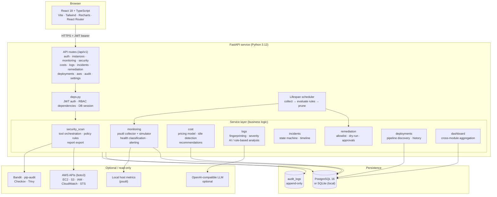
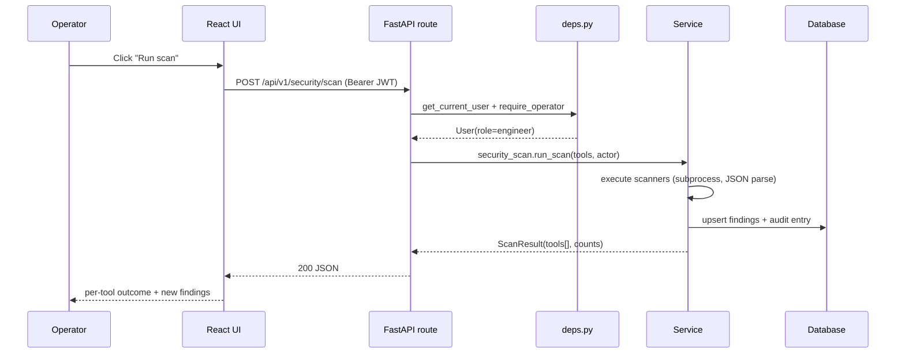

# Architecture

CloudOps Sentinel is a three-tier platform: a React operations console, a FastAPI service layer that owns all
business logic, and a relational store that also acts as the audit system of record. Cloud access is optional and
strictly read-only.

## 1. Component diagram

## 2. Request flow

## 3. Monitoring data flow

1. The lifespan scheduler wakes every `MONITORING_INTERVAL_SECONDS` (default 15s).
2. `collect_local_snapshot` samples the real host with psutil (CPU, virtual memory, disk usage, network
   counters converted to kbit/s using the delta since the previous sample, uptime, process count).
3. `simulate_all` produces synthetic samples for inventory rows marked `source='simulated'`, using a workload
   profile (`web`, `api`, `worker`, `database`, `cache`, `bastion`), a daily sine curve, bounded noise and an
   optional operator-injected spike.
4. Each row is persisted to `metrics` with its `source`, then `evaluate_thresholds` compares the sample with the
   `thresholds` table. Breaches create notifications (rate-limited per instance/signal/level for 10 minutes) and,
   for critical breaches, a deduplicated incident.
5. `prune_history` deletes samples older than `MONITORING_HISTORY_RETENTION_HOURS`.
6. `evaluate_rules` checks remediation rules against the recent sample window and creates dry-run or
   approval-pending actions.

## 4. Data provenance contract

Every record that can be synthetic carries its origin. This is enforced in the schema, not just the UI.

| Entity | Field | Values |
| --- | --- | --- |
| Instance | `source` | `local`, `simulated`, `aws` |
| Metric | `source` | `local`, `simulated` |
| SecurityFinding | `source_kind` + `scan_source` | `aws`, `simulated`, `tool`, `rule-engine` |
| CostRecord | `source` | `simulated`, `estimated`, `aws` |
| Deployment | `source` | `simulated`, `pipeline` |
| LogAnalysis | `source` | `ai`, `rule-based` |

Rules that follow from this:

* A simulated instance can never be presented as a real server; the API and UI label it.
* AWS inventory is only `source=aws` when a boto3 call actually returned it.
* A scanner that is not installed produces a `skipped` status with zero findings — never invented findings.
* Cost figures are `estimated` unless imported from a billing source.

## 5. Clean-architecture boundaries

* **Routes** validate input, authorise, and delegate. No SQL, no business rules.
* **Services** own logic and are importable without FastAPI (used by the scheduler and tests).
* **Models** are persistence only; Pydantic schemas define the wire contract.
* **Cross-cutting concerns** (audit, notifications, settings) are services, not middleware, so background
  work can reuse them.

Dependency direction is one-way: `api → services → models`, with `core` available to all layers. Services never
import routes.

## 6. Deployment topologies

| Mode | Components | Notes |
| --- | --- | --- |
| Local (default) | uvicorn + Vite dev server + SQLite | Zero external dependencies, no cost |
| Container | compose: nginx frontend, uvicorn backend, PostgreSQL 16, optional Redis | `docker compose up -d --build` |
| Kubernetes | Same images, StatefulSet Postgres, 2×2 Deployments, probes, HPAs | kind/minikube is enough; no paid cluster required |
| AWS | Optional read-only role + EC2/S3/CloudWatch via Terraform | `instance_count` defaults to 0 so a plan is free |

## 7. Failure behaviour

* AWS unreachable or uncredentialled → mode `not_configured`, cloud panels show simulated data, the rest of the
  platform is unaffected.
* Scanner missing → `skipped` status surfaced in the scan result.
* LLM unreachable → logged warning and deterministic rule-based analysis (the response's `source` field says so).
* Scheduler exception → logged, exponential backoff capped at 5 minutes; the API keeps serving.
* Database unavailable → `/health` returns `degraded` and reports the error.
